# Program Diagram 使用说明 · User Guide

一个 Rhino 8 体块模型 → 一套 11×17 横版、分层的 Illustrator 分析图：总平面、各层平面、剖面、立面、场地 / 叠合 / 爆炸 / 分层轴测、面积图和饼图，图上带功能名、图例、比例尺和指北针。

下面所有图都是插件**真实导出**的结果（示例模型 `examples/Stacked_Library_Demo.3dm` + 配色 `palettes/palette_oma_scl.json`），没有后期修图。

> 示例模型参考西雅图中央图书馆（OMA / LMN, 2004）的楼层与功能（Parking、Staff、Living Room、Meeting Platform、Mixing Chamber、Book Spiral、Reading Room、Headquarters 等），几何是脚本生成的简化研究体块，不是原设计模型；配色为近似。

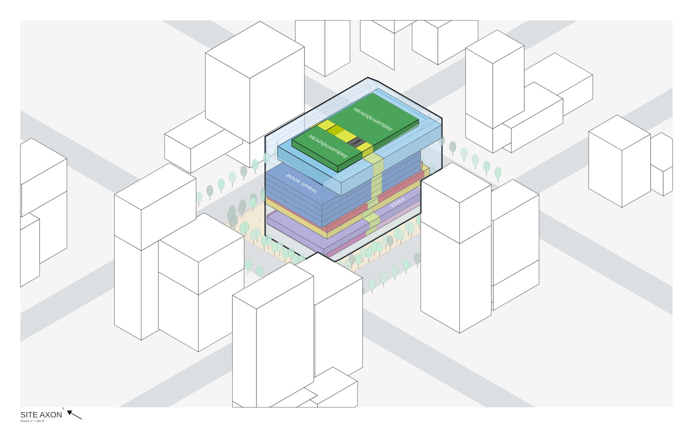

---

## 1. 安装（Windows · Rhino 8，不需要管理员权限）
1. 解压 `download/ProgramDiagram-Public-0.9.0.zip`，把整个 `ProgramDiagram` 文件夹放到用户目录（如 `文档\Rhino\ProgramDiagram`），里面的文件不要拆开。
2. 把 `ProgramDiagram.rhp` 拖进 Rhino 8 窗口，重启 Rhino。
3. 命令行输入 `ProgramDiagram`，打开面板。
4. 被 Windows 拦截：右键压缩包 › 属性 › 勾选「解除锁定」，重新解压。
5. 要生成 `.ai` 需要 Adobe Illustrator；没有也会得到 SVG 预览和一个之后能在 AI 里运行的脚本。

## 2. 建模：只有 4 条规矩
| 放什么 | 图层名 | 插件识别为 |
|---|---|---|
| 每个功能一个**封闭实体** | `PROGRAM::Reading Room`、`PROGRAM::Book Spiral` | 功能色块、标签、面积 |
| 楼板 | `FLOOR PLATE` | 楼层（最可靠的楼层来源） |
| 核心筒、楼梯电梯（**通高一根**即可） | `CORE`、`STAIR` | 平面灰块；爆炸轴测里连接上下层 |
| 外皮玻璃 | `CW-SKIN`、`GLASS` | 平面玻璃线、立面、轴测半透明 |
| 周边建筑 / 道路 / 树 | `CONTEXT`、`ROAD`、`TREES`（本项目的放 `NC::TREES`、`NC::PLAZA`） | 场地底图、配景 |

- 体块从**楼板顶面建到上层楼板底**；同层不同功能**不要重叠**，贴着建。
- **不要给体块起对象名**：有对象名时图上标签显示对象名，没有时显示功能名。
- 树每棵一个物体（方块就行），插件取中心和高度，自己画树；人物会按功能自动放。

示例模型的图层（打开 `Stacked_Library_Demo.3dm` 看）：`PROGRAM::Parking / Staff / Children's / Auditorium / Living Room / Meeting Platform / Mixing Chamber / Book Spiral / Reading Room / Headquarters / Circulation`、`CORE`、`STAIR`、`FLOOR PLATE`、`CW-SKIN`、`CONTEXT`、`ROAD`、`TREES`、`NC::TREES`、`NC::PLAZA`。

## 3. 面板九步
| 步 | 做什么 | 示例模型里 |
|---|---|---|
| ① Layers | 每个图层一个角色，按图层名自动预填 | 全部自动认好，直接 Confirm |
| ② Cleanup | 非封闭体块、单张曲面、跨层、重叠的处理方式 | 无问题 |
| ③ Levels | 检查楼层标高，可改名 / 设夹层 | B1 + L1–L11 + 屋面 |
| ④ Names | 标签和稳定编号（如 `L04_MEETING_01`），可单独改功能 | 默认 |
| ⑤ Colors | 配色方案；**Import scheme JSON…** 导入 `palettes/` 里的方案 | 导入 `palette_oma_scl.json` |
| ⑥ Sections | 画剖切线（`ProgramDiagramPickSection`），设看向 | 东西向穿过平台中部画一条 |
| ⑦ Elevations | 画立面线 | 可跳过 |
| ⑧ Output | 保存位置、**图幅 11x17 Landscape**、比例、要哪些图，然后 **Export** | 平面 / 剖面 1/32" = 1'-0"；轴测 1" = 100'-0" |
| ⑨ Check | 汇总还没处理的问题 | — |

每次导出在模型旁新建一个文件夹：`.ai`、`_preview/*.svg`、`program_areas.csv`、日志。

## 4. 出来的图
**各层平面**（功能名、图例、比例尺、指北针、层名；下面没剖到的楼层以顶视显示）

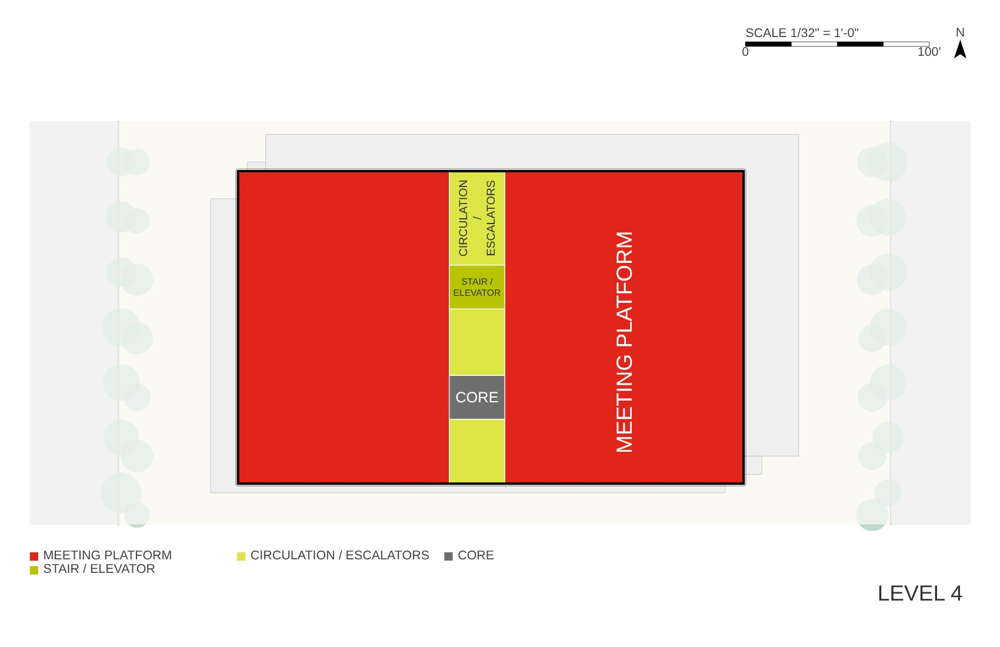
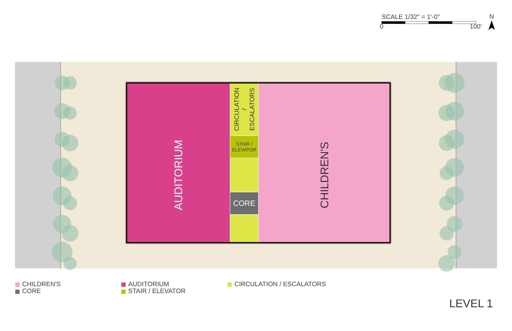
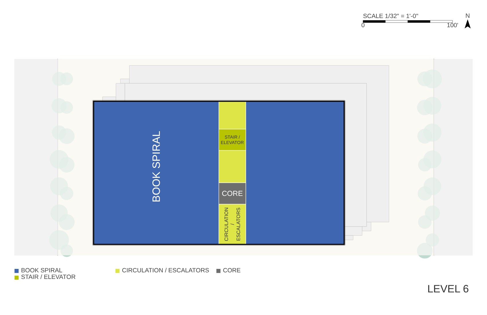

**剖面**（层标高、功能条、剖到的树和周边）

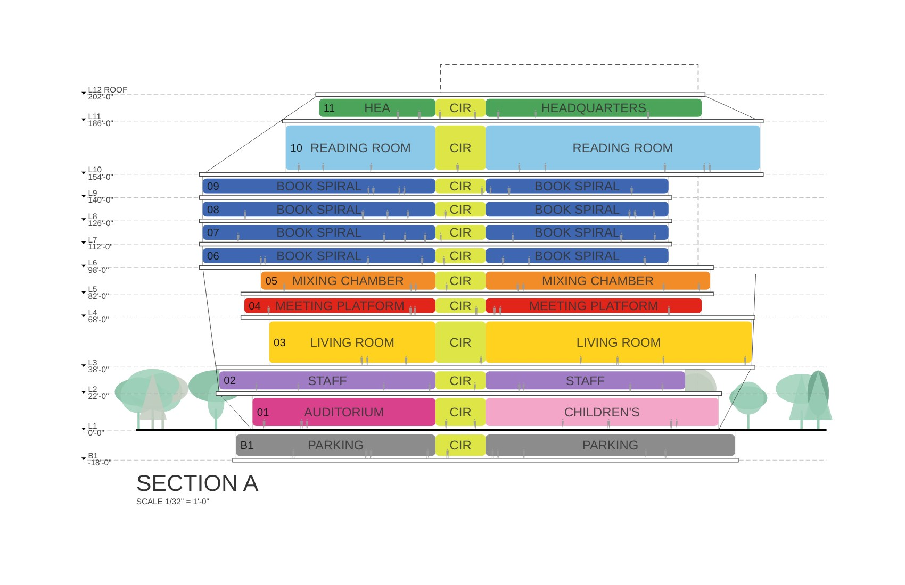

**叠合轴测 · 分层轴测**

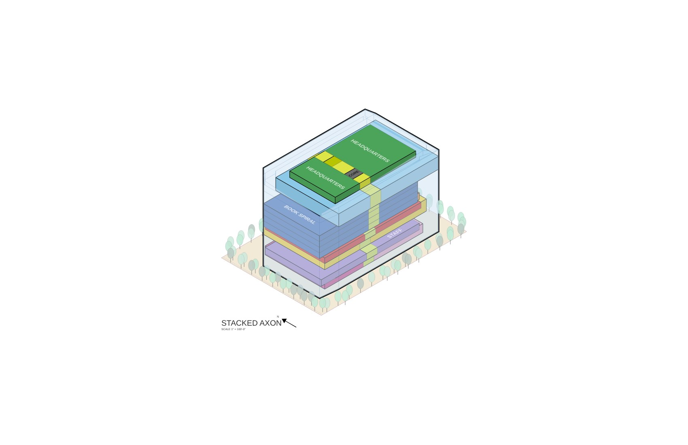
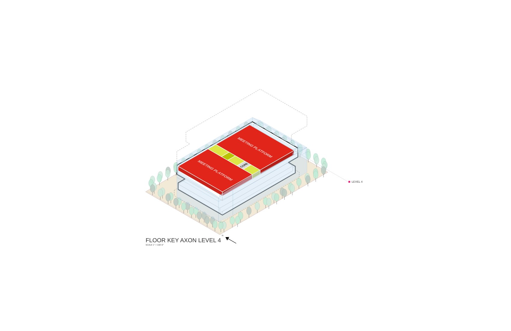

**总平面 · 面积图**

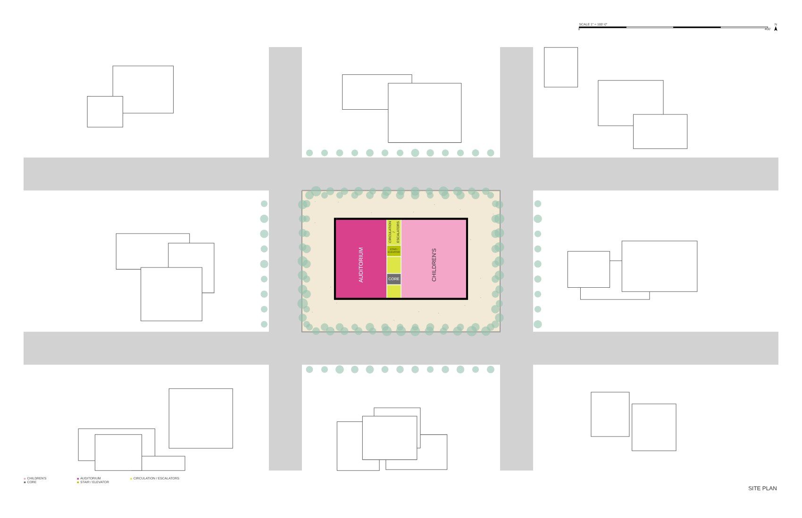
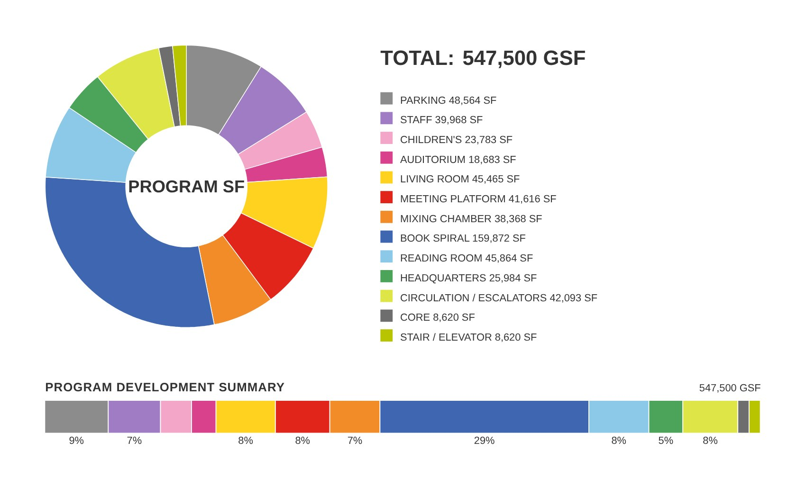
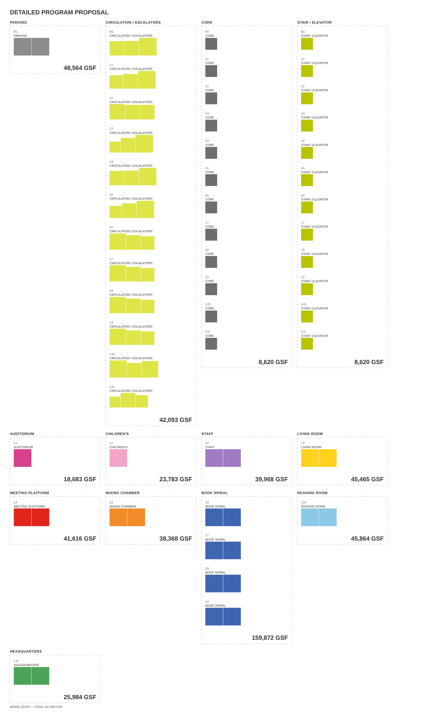

**图例页**（所有图例、线型、指北针、比例尺、配景符号，可直接复制）

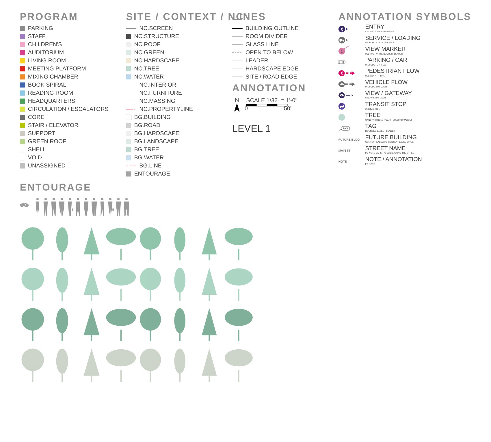

## 5. 换配色
第 ⑤ 步 › Import scheme JSON… › 选 `palettes/` 里的一份 › 重新导出，所有图原位换色（AI 里是全局色板）：
- `palette_riso.json`：孔版印刷油墨色（默认）
- `palette_nordic_mist.json`：北欧雾
- `palette_bauhaus.json`：包豪斯三原色
- `palette_ink_wash.json`：水墨 + 一个朱红
- `palette_oma_scl.json`：示例模型的功能名和配色

自己的项目：在第 ⑤ 步直接改颜色、加功能，改完 Save 成自己的方案。

## 6. 在 Illustrator 里继续画
- 自己加的东西画在 `_MANUAL` 或 `OVERLAY` 图层，重新导出永远不动。
- 插件生成的对象都有名字，重新导出按名字原位替换。
- 人和树是 Symbol（`PD_PERSON_*`、`PD_TREE_*`）：改了 Symbol 造型，重新导出会保留。

## 7. 常见问题
- **显示 Unassigned / 颜色不对**：第 ① 步这个图层没选功能，或第 ⑤ 步方案里没有这个名字。
- **标签是一串编号**：体块有对象名，删掉对象名或在第 ④ 步改。
- **少了一层**：第 ③ 步检查；楼板放 `FLOOR PLATE` 最稳。
- **爆炸轴测放不进 11×17**：楼层多时把图幅改成 Fit content，或用更小的比例。
- **Mac / Rhino 7**：暂不支持。

问题反馈：附上 `export_log.txt`、`illustrator_log.txt` 的 WARN / ERROR 行和截图。

---
Program Diagram · by Chunya Wu · 仅供学习和个人项目免费使用，请勿二次上传或售卖。
